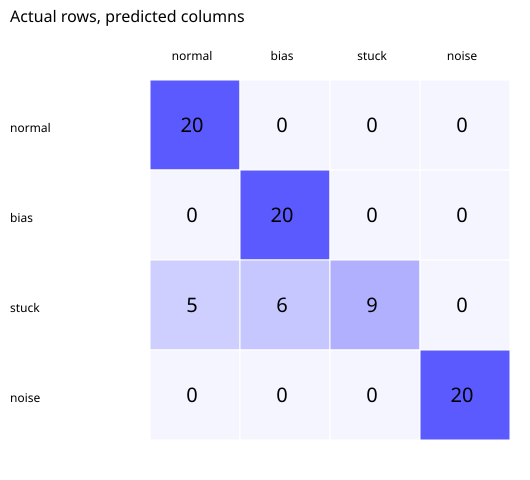

# Steering Fault Diagnosis

**Interpretable statistical feature extraction and nearest-centroid classification of steering-angle sensor faults**

  

## Overview

A reproducible Python baseline for identifying four steering-angle signal conditions: **normal**, **additive bias**, **stuck sensor**, and **high noise**. The project generates synthetic, fixed-length sensor windows, computes interpretable signal statistics, and evaluates a nearest-centroid classifier on a separate test partition.

This project explores condition monitoring of electric steering sensors; it does **not** validate an on-vehicle diagnostic system.

## Signal generation and method

The seeded generator (`42`) creates **400 windows** with **120 samples each** and balanced class counts. The nominal waveform combines a fundamental sinusoid and third harmonic with random phase. Simulated faults are injected as a `+7.5` offset, a frozen signal after one-third of the window, or increased Gaussian noise.

Four features are extracted per window:

1. Signal mean.
2. Signal standard deviation.
3. First-difference standard deviation.
4. Maximum absolute step change.

The model estimates feature centroids from **320 training windows** and predicts the nearest class using normalized squared Euclidean distance. The remaining **80 windows** form a held-out synthetic test split.

## Reported synthetic-demo results

| Metric | Value |
|---|---:|
| Held-out test windows | 80 |
| Overall accuracy | 86.25% |
| Recall: normal | 100% |
| Recall: bias | 100% |
| Recall: stuck | 45% |
| Recall: noise | 100% |



**Interpretation:** The low stuck-sensor recall shows that the chosen statistics do not robustly separate every fault pattern. These metrics reflect only the synthetic generator and should not be generalized to driving conditions.

## Evaluation artifacts

- [`results/metrics.json`](results/metrics.json): Summary metrics.
- [`results/classification_report.csv`](results/classification_report.csv): Per-class precision, recall and F1.
- [`results/confusion_matrix.csv`](results/confusion_matrix.csv): Confusion counts.

## Limitations and next steps

The dataset does not cover steering hardware, variation across driving maneuvers, sampling frequencies, sensor drift, compound faults, or temperature changes. Future evaluation should use recorded steering-angle signals, vehicle-grouped train/test splits, temporal features, and stronger baselines.

## Reproduce the results

```bash
git clone https://github.com/nabinkandel07/Steering-Fault-Diagnosis.git
cd Steering-Fault-Diagnosis
python src/run_demo.py
python -m unittest discover -s tests -v
```

**Requirements:** Python 3.10 or later is recommended. The current demonstration uses only the Python standard library; no third-party dependencies are required.

## Repository structure

```text
.
├── src/run_demo.py       # Runnable demonstration
├── tests/test_demo.py    # Verification tests
├── docs/
│   ├── METHODOLOGY.md    # Model and experimental design
│   ├── RESULTS.md        # Result interpretation and limitations
│   └── DATA_DICTIONARY.md
├── requirements.txt
├── CITATION.cff
└── README.md
```

See the `results/` directory for the committed evaluation artifacts and figures, except the robotics repository, which uses `Results/`.

## Documentation and citation

Detailed assumptions and experimental settings are documented in [Methodology](docs/METHODOLOGY.md). See [Results](docs/RESULTS.md) for interpretation and [Data Dictionary](docs/DATA_DICTIONARY.md) for exported fields. Citation metadata is provided in [CITATION.cff](CITATION.cff).

## Author

**Nabin Kandel**  
Control Science and Engineering, Zhejiang Sci-Tech University  
[GitHub](https://github.com/nabinkandel07) · [Email](mailto:nabinkandel60@gmail.com)
